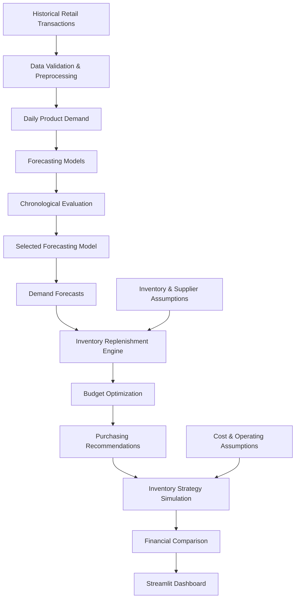

# AI Retail Demand Forecasting & Inventory Optimization

### Predictive Demand Analytics, Inventory Planning & Budget-Constrained Optimization

An open-source retail analytics and inventory decision-support application that combines demand forecasting, replenishment planning, mathematical optimization, and financial simulation.

The system analyzes historical sales transactions, predicts future product demand, recommends inventory replenishment quantities, and evaluates purchasing strategies under different operational constraints.

Built with **Python, Streamlit, StatsForecast, and Google OR-Tools**, the application provides an integrated environment for evaluating data-driven inventory management decisions.

---

## Overview

Effective inventory management requires balancing product availability against purchasing costs, inventory holding expenses, and limited budgets.

Traditional replenishment strategies frequently rely on historical averages, fixed reorder levels, and manual estimates.

These approaches may struggle with:

- Fluctuating product demand.
- Seasonal sales patterns.
- Demand forecasting errors.
- Overstocking.
- Product shortages.
- Limited purchasing budgets.
- Supplier lead-time uncertainty.
- Complex replenishment decisions.

**AI Retail Demand Forecasting & Inventory Optimization** combines predictive analytics with mathematical optimization to investigate these challenges.

The application supports inventory planning through forecasts, operational constraints, and scenario-based financial comparisons.

It is a decision-support system and does not execute real purchasing transactions.

---

## Key Features

### Demand Forecasting

Predicts future product demand using historical retail transactions.

Supported forecasting horizons:

- 7 days
- 14 days
- 28 days

The application provides:

- Historical sales visualizations.
- Product-level demand forecasts.
- Forecast-versus-actual comparisons.
- Model performance metrics.
- Forecast error analysis.
- Interactive product selection.

### Multiple Forecasting Models

The forecasting engine supports four methods.

| Model | Description |
|---|---|
| Seasonal Naive | Uses historical seasonal patterns as a baseline |
| Moving Average | Forecasts demand using recent historical averages |
| AutoETS | Automated exponential smoothing |
| Croston SBA | Forecasting method for intermittent demand |

Models are evaluated using chronological backtesting.

**AutoETS** was selected based on development evaluation results.

### Inventory Replenishment Recommendations

Converts demand forecasts into purchasing recommendations.

The replenishment engine considers:

- Predicted demand
- Current inventory
- Supplier lead times
- Safety stock
- Minimum order quantities
- Pack sizes
- Purchasing costs
- Budget limitations

Inventory assumptions can be modified interactively.

Recommendations update according to the selected parameters.

### Budget-Constrained Optimization

Uses Google OR-Tools with the SCIP solver to generate purchasing allocations under financial and operational constraints.

The optimizer considers:

- Available purchasing budget
- Product costs
- Inventory requirements
- Minimum order quantities
- Pack-size restrictions
- Purchasing quantity limits

Optimization outputs include recommended quantities and estimated expenditure.

The application provides simulated accept/reject controls for proposed purchasing plans.

No real orders are placed.

### Inventory Strategy Comparison

The simulation engine compares three replenishment approaches:

**Strategy A — Traditional Baseline**

A conventional replenishment policy.

**Strategy B — Forecast-Informed Replenishment**

Inventory planning using predicted product demand.

**Strategy C — Budget-Constrained Optimization**

Forecast-informed purchasing recommendations adjusted using mathematical optimization.

The system compares modeled operating costs and inventory outcomes across these strategies.

### Financial Impact Simulation

Evaluates inventory strategies under configurable business assumptions.

Supported analysis includes:

- Purchasing expenditure
- Inventory holding costs
- Shortage penalties
- Inventory availability
- Total modeled operating costs
- Strategy comparisons
- Scenario sensitivity analysis

Financial outcomes are simulation results, not verified business savings.

### Interactive Analytics Dashboard

The application contains six pages:

1. **Executive Dashboard** — Operational overview and KPIs.
2. **Demand Forecasting** — Historical sales, predictions, and model comparisons.
3. **Inventory Recommendations** — Suggested replenishment quantities.
4. **Budget Optimization** — Constrained purchasing allocation.
5. **Business Impact** — Financial simulation and strategy comparisons.
6. **Evaluation & Deployment Readiness** — Forecast performance and deployment assessment.

Additional functionality includes editable assumptions, interactive charts, simulated purchasing decisions, and CSV exports.

---

## System Architecture



### Processing Workflow

1. Historical transaction records are loaded and validated.
2. Sales data is transformed into daily product-level demand.
3. Forecasting models are evaluated using chronological backtesting.
4. A forecasting model is selected using development results.
5. Future demand is estimated.
6. Inventory replenishment requirements are calculated.
7. Purchasing recommendations are optimized under budget constraints.
8. Inventory strategies are simulated and compared.
9. Results are presented through the interactive dashboard.

---

## Technology Stack

| Technology | Purpose |
|---|---|
| Python | Core application |
| Pandas | Data processing |
| NumPy | Numerical calculations |
| StatsForecast | Time-series forecasting |
| Google OR-Tools | Purchasing optimization |
| SCIP | Mixed-integer optimization solver |
| Streamlit | Interactive application |
| Plotly | Data visualization |
| Pytest | Automated testing |

All core analytical components execute locally.

---

## Dataset

The application uses the **[UCI Online Retail dataset](https://archive.ics.uci.edu/dataset/352/online+retail)**, containing historical transactions from a UK-based online retailer.

Citation: Chen, D. (2015). Online Retail [Dataset]. UCI Machine Learning Repository. [https://doi.org/10.24432/C5BW33](https://doi.org/10.24432/C5BW33). Licensed under [CC BY 4.0](https://creativecommons.org/licenses/by/4.0/). This project filters and aggregates the original transactions.

### Dataset Information

| Property | Value |
|---|---|
| Source | UCI Machine Learning Repository |
| Dataset | Online Retail |
| License | CC BY 4.0 |
| Raw transaction records | 541,909 |
| Retained positive-sales records | 520,893 |
| Products analyzed | 25 |
| Historical period | December 2010 – December 2011 |

The selected products were identified using training history only.

Customer identifiers are excluded from exported data.

### Data Processing

The preprocessing pipeline handles:

- Missing values.
- Invalid transaction records.
- Returns and cancellations.
- Negative quantities.
- Invalid prices.
- Product identification.
- Daily aggregation.
- Historical training and evaluation periods.

The final partial observation day was excluded.

Dataset provenance and checksums are recorded to support reproducibility.

### Data Limitations

Historical sales transactions do not provide complete information about:

- Actual historical stock levels.
- Supplier purchasing costs.
- Supplier lead times.
- Lost sales caused by stockouts.
- Inventory holding expenses.

These variables are modeled using configurable assumptions.

The application distinguishes observed transaction data from simulated inventory and financial information.

---

## Forecasting Methodology

### Chronological Evaluation

Forecasting models are evaluated using time-ordered data.

Random train/test splitting is avoided.

The evaluation includes:

- Three chronological development windows.
- Model comparison using historical observations.
- Model selection based on development performance.
- A separate final holdout period.

This design reduces the risk of future information leaking into training.

### Evaluation Metrics

The application reports:

**MAE — Mean Absolute Error**

Average absolute difference between predicted and observed demand.

**RMSE — Root Mean Squared Error**

A measure of forecasting error that penalizes large deviations.

**WAPE — Weighted Absolute Percentage Error**

Aggregate absolute forecasting error relative to observed sales.

**Bias**

Systematic overprediction or underprediction.

**MASE — Mean Absolute Scaled Error**

Forecasting error relative to a historical naive reference.

---

## Forecasting Results

### Selected Model: AutoETS

| Metric | Development | Final Holdout |
|---|---:|---:|
| MAE | 43.125 | 50.010 |
| RMSE | 112.235 | 156.552 |
| WAPE | 79.15% | 70.54% |
| Bias | −5.92% | −20.85% |
| MASE | 0.876 | 0.922 |

AutoETS achieved a **16.94% improvement in development WAPE** compared with the seasonal naive baseline.

However, absolute forecasting errors remained substantial.

The final holdout results indicate significant uncertainty in product-level demand predictions.

The model's forecasting improvement should not be interpreted as proof of improved inventory profitability.

---

## Inventory Optimization

The optimization engine uses Google OR-Tools to allocate purchasing budgets across products.

### Supported Constraints

- Maximum purchasing budget
- Nonnegative integer purchasing quantities
- Minimum order quantities
- Pack-size requirements
- Replenishment quantity limits

Simulation checks also verify stock conservation.

The implementation was validated across nine strategy/scenario combinations.

All tested optimization constraints passed.

---

## Business Impact Analysis

The application evaluates three inventory strategies using a reproducible financial simulation.

### Base Scenario

| Strategy | Modeled Operating Cost | Difference |
|---|---:|---:|
| A — Traditional Baseline | £75,697.39 | — |
| B — Forecast-Informed | £76,682.09 | +1.30% |
| C — Optimized | £77,481.13 | +2.36% |

Under the base assumptions, the traditional replenishment strategy produced the lowest modeled operating cost.

The forecasting and optimization strategies did not outperform the traditional baseline.

### Alternative Scenarios

The optimization strategy performed better under selected operational constraints.

| Scenario | Modeled cost reduction |
|---|---:|
| Tight purchasing budget | 3.35% |
| Slow supplier replenishment | 3.98% |

These outcomes demonstrate that optimization performance depends on operating conditions.

### Simulation Assumptions

The financial model includes assumptions about inventory levels, supplier constraints, and costs.

Purchasing prices are estimated at **50% of median historical retail prices from the training data**.

This assumption is illustrative and does not represent verified supplier costs.

**No real financial savings or return on investment have been established.**

---

## Getting Started

### Requirements

- Python 3.11+
- Sufficient memory for local analytics
- A modern web browser

### Installation

Navigate to the project directory:

```bash
cd /home/user/PortfolioProject3
```

Create and activate a virtual environment if one does not already exist:

```bash
python3 -m venv .venv
source .venv/bin/activate
```

Install dependencies:

```bash
python -m pip install -r requirements.txt
```

### Start the Application

```bash
streamlit run app.py
```

Open:

`http://127.0.0.1:8501`

The checked-in processed data and reports support immediate dashboard use after installation. To reproduce the data preparation, evaluation, and simulation, run:

```bash
python -m scripts.download_data
python -m scripts.prepare_data
python -m scripts.train_models
python -m scripts.run_evaluation
python -m scripts.run_simulation
python -m scripts.generate_reports
```

For the exact tested package versions, install `requirements-lock.txt` instead of `requirements.txt`. Product selection and the initial holdout are preserved by checksum checks; see [evaluation details](reports/forecast-evaluation.md).

---

## Testing & Verification

The application includes automated tests covering:

- Data validation
- Sales preprocessing
- Chronological data splitting
- Forecast generation
- Forecast evaluation
- Inventory calculations
- Budget optimization
- Inventory simulation
- Financial calculations
- Dashboard consistency

### Automated Tests

Final verification reported:

**55 passed, 0 failed, 0 skipped.**

A separate clean reproduction confirmed identical prepared-data checksums and numerically identical development, holdout, and simulation comparison results.

### Browser Verification

The Streamlit application was tested using Chromium.

Verified functionality includes:

- Navigation across all six pages
- Forecast controls
- Budget modifications
- Zero-budget optimization
- Simulated purchasing decisions
- Dashboard rendering

No browser console errors were reported.

### Running Tests

```bash
python -m pytest -q
```

---

## Deployment Readiness

The system supports analytical experimentation and inventory-planning simulations.

### Current Assessment

| Environment | Recommendation |
|---|---|
| Local demonstration | GO |
| Controlled analytical shadow pilot | CONDITIONAL GO |
| Production purchasing operations | NO-GO |

### Production Requirements

Before considering production use, the system would require:

- Validated inventory records.
- Verified purchasing costs.
- Actual supplier lead-time data.
- More comprehensive forecasting history.
- Operational integration.
- Model performance monitoring.
- Access controls.
- Business-user acceptance testing.
- Demonstrated economic value under real conditions.

The base simulation does not justify replacing the traditional replenishment policy.

---

## Known Limitations

- Forecasting errors remain high.
- Historical data covers approximately one annual cycle.
- Observed sales may underestimate true demand during stockouts.
- Historical inventory records are unavailable.
- Supplier lead times are simulated.
- Purchasing costs are estimated.
- Financial outcomes depend on modeling assumptions.
- No live inventory or purchasing systems are connected.
- The application does not execute real purchases.
- Production deployment has not been validated.

---

## Future Development

Potential improvements include:

- Additional forecasting models.
- Probabilistic demand forecasts.
- Improved handling of intermittent demand.
- Longer historical datasets.
- Supplier lead-time forecasting.
- Real inventory-system integration.
- Product-level service targets.
- More advanced stockout modeling.
- Multi-location inventory optimization.
- Automated model monitoring.
- Real operational cost validation.

---

## Documentation

The repository includes technical documentation, evaluation evidence, and operational analysis.

Key resources:

- [Forecast evaluation](reports/forecast-evaluation.md) — Forecasting methodology and results.
- [Business impact analysis](reports/business-impact-analysis.md) — Inventory strategy comparison.
- [Final verification](reports/final-verification.md) — Reproducibility and test evidence.
- [Project management](project-management/) — Requirements, implementation planning, risk assessment, and deployment readiness documentation.

---

## Development Status

**Current stage:** Functional forecasting and inventory decision-support application.

**Supported use:** Local analytics, experimentation, and inventory strategy simulation.

**Production readiness:** Not approved for automated purchasing operations.

The application demonstrates how forecasting, mathematical optimization, and financial modeling can be combined to support inventory-planning decisions while making uncertainty and operational constraints visible.
