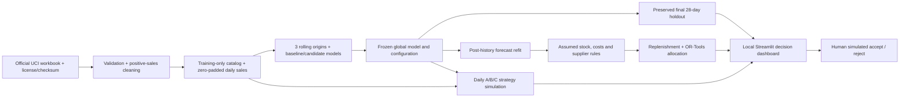
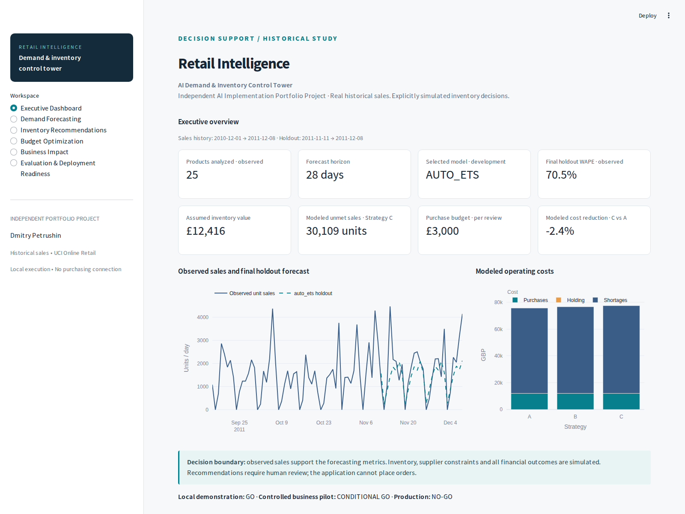
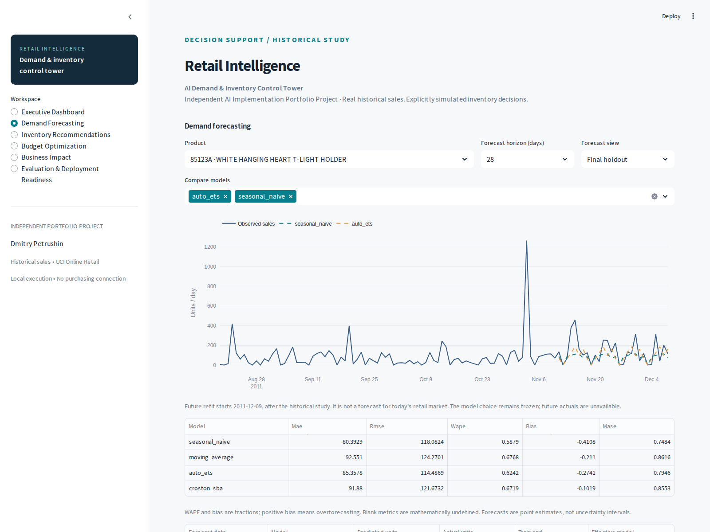
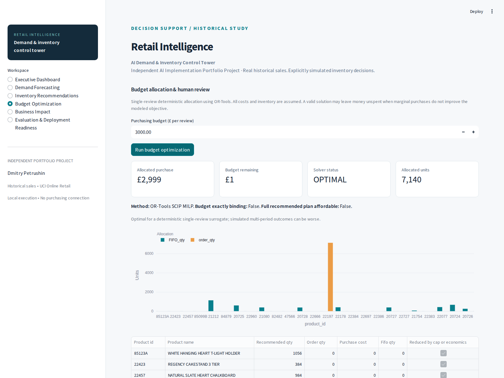
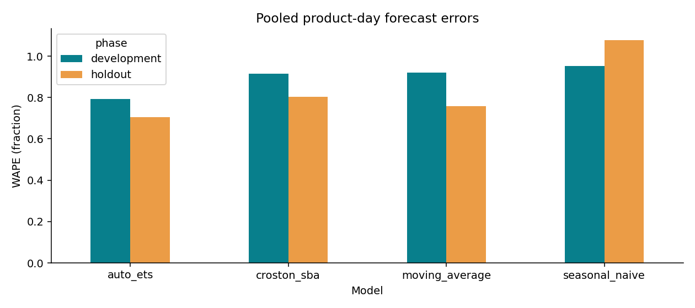

# AI Retail Demand Forecasting & Inventory Decision Support

**Retail Intelligence — AI Demand & Inventory Control Tower**
**Dmitry Petrushin · Independent AI Implementation Portfolio Project**

> This is a self-directed AI implementation portfolio project. The transaction dataset contains historical retail records, while inventory policies, supplier constraints, stakeholder roles, and business scenarios are simulated. The application is not a production inventory management system.

## Executive summary

A working CPU-only forecasting and inventory decision-support application with a measured, deliberately cautious business case. It processes **541,909 real UCI records**, retains **520,893 positive-sales transactions**, selects **25 products using training data only**, compares four forecasting methods and uses OR-Tools to allocate an assumed purchasing budget. Six dashboard pages expose forecasts, configurable inventory assumptions, optimization, simulation and readiness evidence.

**Measured outcome:** AutoETS reduced development WAPE by **16.94%** relative to seasonal naive. Final holdout WAPE was **70.54%** (seasonal naive: 107.83%). Yet in the base simulation Strategy B cost **1.30% higher** and optimized C **2.36% higher** than A. Better forecasting did not establish better purchasing outcomes. The baseline should be retained pending operational validation.

## Business problem

A fictional retailer must balance unavailable stock, slow-moving inventory and a limited budget. Historical averages and manual judgment provide little visibility into forecast error or purchasing tradeoffs. The project turns that problem into explicit requirements, testable hypotheses and separate decisions for a demonstration, analytical pilot and production system. No fictional stakeholder is described as an actual collaborator.

## Solution overview

- Official source acquisition with license/provenance/checksums and a reproducible quality report.
- Weekly seasonal naive, 28-day moving average, StatsForecast AutoETS and Croston SBA; 7/14/28-day forecasts.
- Three rolling development windows, training-only catalog/price metadata, frozen selection and preserved holdout.
- Explainable order-up-to policy, integer-pack OR-Tools allocation and labeled deterministic fallback.
- Daily lost-sales simulation with A/B/C comparators and three assumption scenarios.
- Local human review with editable assumptions, budget changes, accept/reject and CSV exports; no real orders.

## Architecture



Modules live in `src/`, reproducible entry points in `scripts/`, fixed configuration in `config/`, small evidence in `reports/`, and business/PM materials in `project-management/` and `portfolio/`. No remote inference, paid API, database or Docker is required.

## Screenshots

Genuine local Chromium captures; see [capture details](screenshots/README.md).



| Forecasting | Budget optimization |
|---|---|
|  |  |

Additional captures: [inventory](screenshots/03-inventory-recommendations.png), [business impact](screenshots/05-business-impact.png), [evaluation/readiness](screenshots/06-evaluation-readiness.png).

## Technology stack

Python 3.11+ (verified on 3.12.3), pandas/NumPy, StatsForecast, OR-Tools SCIP, Streamlit, Plotly, matplotlib and pytest. Statistical models are sufficient for this small predictive-analytics study; no LLM or GPU is used. Direct dependencies are pinned in `requirements.txt`; the exact tested environment is pinned in `requirements-lock.txt` and recorded in the protocol. AutoARIMA was omitted to keep CPU work bounded.

## Dataset source and attribution

[UCI Online Retail, dataset 352](https://archive.ics.uci.edu/dataset/352/online+retail). Chen, D. (2015). Online Retail [Dataset]. UCI Machine Learning Repository. [DOI: 10.24432/C5BW33](https://doi.org/10.24432/C5BW33). Licensed under [CC BY 4.0](https://creativecommons.org/licenses/by/4.0/).

Real source history: 2010-12-01 through 2011-12-09 12:50. Prepared study ends **2011-12-08**, excluding the final partial calendar day. Cancellation/negative sales, invalid prices/codes/dates and exact duplicates are excluded; returns never become positive demand. All countries are retained. Daily series preserve zero recorded sales from first training-observed sale onward. Customer and invoice IDs are omitted from exports. Modified derivatives retain CC BY attribution; project code/original docs are MIT.

[Data documentation](data/README.md) · [Source manifest/checksums](data/source-manifest.json) · [Measured quality report](reports/data-quality-report.md). Raw workbook/archive are ignored by Git. The prepared derivative contains 9,323 rows, and 21.7% have zero recorded sales. Sales are not unconstrained demand: stockout availability is unknown.

## Forecasting methodology

Selection cutoff **2011-08-18** precedes every validation window. Require 90 active days and 180 calendar days of history; rank by active days, unit volume, then code; retain 25. Product names and median retail-price proxies are also training-only. No weak products are excluded after evaluation.

Development origins are 2011-08-18, 2011-09-15 and 2011-10-13; each predicts 28 days. Select one global model by pooled development WAPE, ties by configured model order. Freeze processing/model/evaluation/configuration/data hashes before the final holdout **2011-11-11–2011-12-08**. Leading 7/14-day results are also exported. The ≥5% development improvement gate is predeclared and was not changed after seeing the holdout.

MAE and RMSE use product-day errors; WAPE is total absolute error / total actual units; bias is signed total error / total actual units. MASE uses each training prefix's seven-day seasonal absolute-difference scale, averaging defined scaled errors. Zero denominators remain undefined/blank, with coverage counts. These pooled metrics do not cancel errors across products. Fallbacks and effective models are explicit; measured development/holdout fallback rows: 0.

## Model comparison and evaluation results

Primary 28-day horizon; WAPE/bias values in the table are fractions, not percentages.

| phase       | model          |     mae |     rmse |   wape |    bias |   mase |
|:------------|:---------------|--------:|---------:|-------:|--------:|-------:|
| development | seasonal_naive | 51.9224 | 138.4372 | 0.9530 | -0.1225 | 1.0491 |
| development | moving_average | 50.1470 | 117.0602 | 0.9204 |  0.0082 | 1.0108 |
| development | auto_ets       | 43.1250 | 112.2345 | 0.7915 | -0.0592 | 0.8760 |
| development | croston_sba    | 49.8645 | 117.4620 | 0.9152 | -0.0132 | 0.9919 |
| holdout     | seasonal_naive | 76.4486 | 224.7853 | 1.0783 |  0.1725 | 1.2757 |
| holdout     | moving_average | 53.7207 | 153.2872 | 0.7578 | -0.1362 | 1.0114 |
| holdout     | auto_ets       | 50.0104 | 156.5523 | 0.7054 | -0.2085 | 0.9220 |
| holdout     | croston_sba    | 57.0434 | 152.5386 | 0.8046 | -0.0068 | 1.0474 |

Selected final holdout MAE **50.010**, RMSE **156.552**, WAPE **70.54%**, bias **-20.85%**, MASE **0.922**. All models actually ran. No holdout tuning was performed. A later full-history refit produces forecasts for 2011-12-09–2012-01-05 for the historical demonstration, not today's market. Its future actuals are unavailable.



[Full evaluation](reports/forecast-evaluation.md) · [Product failures](reports/forecast-failure-analysis.md) · [Machine-readable comparison](reports/model-comparison.csv) · [Frozen protocol](reports/frozen-protocol.json) · [Initial holdout manifest](reports/holdout-manifest.json).

## Inventory optimization

Target = forecast units over lead + review days + safety stock. Inventory position = on hand + on order. Positive purchase need is rounded up to a pack multiple and MOQ. The optional integer-pack MILP minimizes purchase plus target-shortage/excess cost while enforcing a hard budget in pennies. It reports optimal/feasible/infeasible status; allocation is independently validated. Zero orders are feasible under a zero budget. Required-product tests demonstrate actual infeasibility; inability to fund every target is otherwise a soft shortfall.

A uses an expanding historical average + product-code FIFO budget allocation; B uses the selected forecast + the same FIFO; C uses the selected forecast + optimization. [Mathematical formulation and constraints](reports/optimization-methodology.md). If OR-Tools is unavailable, the app labels a FIFO fallback and makes no optimality claim. OR-Tools SCIP was used for the recorded results.

## Business impact simulation

All policies see identical realized sales-proxy histories and costs under each scenario, with no future sales exposed at ordering time. Base assumptions: 7-day lead, 7-day review, initial 7-day stock cover, z=1.28 safety buffer, six-unit packs, MOQ 12, **£3,000 per review**. Purchase unit cost is **assumed 50% of training median retail price**, rounded to pennies; annual holding 25%; shortage penalty twice assumed purchase cost. Tight budget uses £1,500; slow supply uses a 14-day lead and higher buffer/penalties. See [exact JSON](config/scenarios.json).

Base modeled operating costs: A **£75,697.39**, B **£76,682.09**, C **£77,481.13**. Base modeled fill rates are 47.1%, 45.0%, 39.3%; these stressed budgets do not produce acceptable service. C's modeled cost reductions versus A in tight-budget/slow-supply scenarios are **3.35% / 3.98%**. These are not verified savings or ROI.

Total modeled operating cost = purchases + daily closing-stock holding + unfilled-sales penalties. Average inventory, unmet units, period turnover, fill rate, terminal stock and in-transit assets are also reported. Asset-adjusted cost includes initial inventory value and credits closing/in-transit assets, exposing short-horizon accounting sensitivity. The single-review optimizer does not guarantee the best realized multi-period outcome.

[Business analysis](reports/business-impact-analysis.md) · [Summary CSV](reports/simulation-summary.csv) · [Assumption/cost caveats](project-management/09_business_case_and_roi.md).

## Project management

The [12-document PM set](project-management/) includes a charter, traceable requirements, explicitly hypothetical six-week roadmap, fictional stakeholder communication/RACI, 21-risk register, fixed acceptance gates, test strategy, measured model report, financial case, readiness decision, adoption/rollback plan and genuine lessons. [Recruiter case study](portfolio/case-study.md) · [Two-minute demo](portfolio/demo-guide.md).

## Installation

```bash
cd /path/to/PortfolioProject3
python3 -m venv .venv
source .venv/bin/activate
python -m pip install -r requirements-lock.txt
python -m pip check
```

Python 3.11/3.12 is recommended; this run used Python 3.12.3 on Linux. Internet is needed only for installing packages and the official data download. Inference, optimization and the dashboard run locally. No secrets or cloud setup are needed. Direct pinned dependencies can instead be installed with `-r requirements.txt`; the lock is preferred for exact reproduction.

## Running the application

The checked-in small processed data/reports support immediate dashboard review after installation:

```bash
streamlit run app.py
```

Open **http://127.0.0.1:8501**. Use the sidebar for all six pages. Edit stock/lead/safety assumptions under Inventory Recommendations; Budget Optimization uses those session inputs. Changing inputs invalidates an earlier approval. Accept/reject is session-only and submits nothing. The fixed Business Impact experiments do not change when editing a live proposal.

## Reproducing experiments

```bash
python -m scripts.download_data
python -m scripts.prepare_data
python -m scripts.train_models
python -m scripts.run_evaluation
python -m scripts.run_simulation
python -m scripts.generate_reports
python -m scripts.write_portfolio
```

Or run `bash scripts/reproduce.sh` after activation. Seed: 42; statistical inference and the one-thread solver are deterministic in the tested environment. Source/version/checksum metadata are retained. Existing initial development/holdout artifacts are verified rather than overwritten. This intentionally prevents accidental tuning against a known holdout. To rerun model fitting independently from scratch, copy the **tracked source/config and the same downloaded raw workbook** into a separate experiment directory, omit generated `reports/` files there (keep the empty `reports/figures/` directory), and run preparation/training/evaluation in that separate directory. Compare its numerical outputs to the preserved initial results. Never delete/replace initial holdout evidence in the main project to bypass a changed protocol.

An automated clean refit in an isolated temporary directory is also available: `python -m scripts.verify_reproduction`. The completed run reproduced prepared-data checksums and development/holdout/simulation metrics exactly (maximum numeric difference 0) in the same Python environment. [Clean reproduction evidence](reports/reproduction-verification.json). Run `python -m scripts.verify_project` to audit document links, privacy, manifests and required deliverables.

If the official source is temporarily unavailable, the checked-in real-data derivatives still support artifact review and the dashboard. A fresh raw-data reproduction remains incomplete until the official file is available. No synthetic data was substituted for the measured study.

## Testing

```bash
python -m pytest --junitxml=reports/test-results.xml
```

The completed local run includes real workbook/model integration, leakage tests, exact metrics, inventory arithmetic, budget/pack/MOQ/infeasibility, brute-force solver comparison, cost/conservation and sensitivity checks, dashboard consistency and Streamlit AppTest. Real-data integration tests skip explicitly if the raw workbook is absent, so download it for a full zero-skip run. [Actual test XML](reports/test-results.xml) · [Browser evidence](reports/browser-verification.md). CI installs pinned dependencies and downloads the same official source; this workflow is provided but has not been run on GitHub because nothing was published.

Measured local run: **55 tests, 0 failures, 0 skips**. See the XML for duration and dependency deprecation warnings.

## Deployment recommendation

Local portfolio demonstration: **GO**. Controlled analytical business pilot: **CONDITIONAL GO**, contingent on real stock/cost/supplier data, human ownership and shadow-mode validation. Production inventory deployment: **NO-GO**. Retain the traditional policy until actual operational benefit is established. [Evidence-based decision](project-management/10_go_no_go_decision.md).

## Limitations

One year of historical wholesale-influenced sales is not current demand. Zero sales are ambiguous; availability and lost demand are unknown. Prices are nominal GBP and costs are assumed. AutoETS has high absolute errors and no calibrated uncertainty intervals. The 28-day simulation has stressed budgets and terminal-value effects; it does not validate ROI or service levels. There is no live integration, authentication, durable approval trail, production monitoring or supplier execution. Live edits illustrate scenarios and do not update the original study. Screenshots and tests establish local behavior, not production readiness.

## Future development

Collect real stock/availability, purchasing price and supplier arrival histories; validate multiple annual cycles; add calendar/holiday features and calibrated intervals in separately labeled experiments; evaluate service and working-capital tradeoffs with multi-period stochastic policies; add durable authorization/audit and operational monitoring only after a real pilot decision. Preserve the original holdout as evidence.
