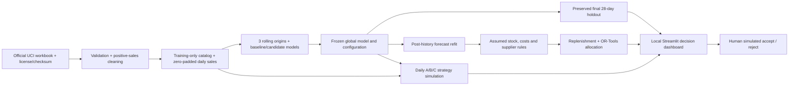

# AI Retail Demand Forecasting & Inventory Decision Support

**Dmitry Petrushin**
**Independent Project Owner — AI Implementation & Project Management**

## 1. Executive summary

I built and validated a local decision-support application that connects real historical retail transactions to sales forecasts, explainable inventory recommendations and budget allocation. I treated forecast quality and modeled business value as separate hypotheses. AutoETS reduced development WAPE by 16.94% relative to seasonal naive, but base-scenario optimized purchasing cost 2.36% more than the traditional comparator. That evidence supports a local demonstration and further conditional analytical validation, not production procurement.

This is a self-directed portfolio project. All company roles and operating scenarios are fictional. I did not claim interviews, team participation, realized savings or a live rollout.

## 2. Business problem

A fictional retailer needs to balance stock availability, overstock and limited purchasing funds. A historical average is easy to use but gives little evidence about forecast quality or how to allocate money among products. The decision problem is broader than choosing the lowest-error model: stock, lead times, safety buffers, order packs and costs interact with forecasts.

## 3. Project objectives

Build an auditable data pipeline; compare statistical models to clear baselines; enforce purchasing constraints; quantify cost/service sensitivity; support human review; and define separate demonstration, pilot and production decisions. The forecast hypothesis was a fixed ≥5% development WAPE reduction, not a guaranteed benefit.

## 4. My role

I translated the brief into requirements and acceptance gates, selected and attributed the dataset, designed leakage controls and evaluation, implemented Python/Streamlit/OR-Tools components, investigated test failures, validated the application and wrote the decision case. The hypothetical Sponsor, Operations, Inventory, Analyst, ML, Finance and QA roles describe how a real organization could govern adoption; they were not actual collaborators.

## 5. Requirements and scope

The implementation covers 25 products, daily sales, 7/14/28-day forecasts, three development windows, one final holdout, three purchasing strategies and three financial scenarios. It runs locally on CPU with open-source packages, without a paid API or mandatory cloud. It cannot place orders. Customer identifiers are absent from processed/demo exports. Real stock reconstruction, procurement integration and production operations are outside scope.

## 6. Implementation approach

I downloaded the official UCI Online Retail workbook under CC BY 4.0, recorded checksums and checked all 541,909 records. The cleaning policy retains 520,893 positive-sales records through 2011-12-08; it excludes returns/cancellations and invalid adjustments instead of converting them to demand. The final partial calendar date is excluded. The catalog uses only data through 2011-08-18, before every validation window. Product names and cost proxies use the same historical boundary.

The hypothetical six-week roadmap separates discovery, preparation, modeling, decision support, validation and pilot assessment. Actual work was independent; manifests, JUnit XML and browser evidence document executed work rather than invented project meetings.

## 7. Technical architecture

Data/configuration and initial evaluation artifacts are hash-verified. The dashboard reads the same measured evidence used by reports. Live assumption edits affect proposed plans, while fixed simulation evidence remains separate. No service holds purchasing credentials or sends orders.

## 8. Model selection

Weekly seasonal naive and a 28-day moving average provide practical reference points. StatsForecast AutoETS adds automatic statistical model fitting, while Croston SBA covers an intermittent-demand approach. Three 28-day rolling-origin windows determine one global model by pooled WAPE, with deterministic tie order. No final-holdout product filtering or tuning is allowed. AutoETS won; the fixed development improvement gate passed. Model errors/short histories use an explicit flagged fallback, not a silently relabeled prediction.

## 9. Forecast evaluation

Final holdout: 2011-11-11–2011-12-08. Selected MAE 50.010, RMSE 156.552, WAPE 70.54%, bias -20.85%, MASE 0.922. Seasonal naive holdout WAPE was 107.83%. These are actual measured results; high absolute error and some product-level regressions remain visible.

| phase       | model          |     mae |     rmse |   wape |    bias |   mase |
|:------------|:---------------|--------:|---------:|-------:|--------:|-------:|
| development | seasonal_naive | 51.9224 | 138.4372 | 0.9530 | -0.1225 | 1.0491 |
| development | moving_average | 50.1470 | 117.0602 | 0.9204 |  0.0082 | 1.0108 |
| development | auto_ets       | 43.1250 | 112.2345 | 0.7915 | -0.0592 | 0.8760 |
| development | croston_sba    | 49.8645 | 117.4620 | 0.9152 | -0.0132 | 0.9919 |
| holdout     | seasonal_naive | 76.4486 | 224.7853 | 1.0783 |  0.1725 | 1.2757 |
| holdout     | moving_average | 53.7207 | 153.2872 | 0.7578 | -0.1362 | 1.0114 |
| holdout     | auto_ets       | 50.0104 | 156.5523 | 0.7054 | -0.2085 | 0.9220 |
| holdout     | croston_sba    | 57.0434 | 152.5386 | 0.8046 | -0.0068 | 1.0474 |

WAPE/bias table values are fractions. Metrics use pooled product-day errors, while MASE uses each product's training-only seasonal scale. Undefined denominators remain blank/null. The initial holdout is preserved and verified on repeat runs; later full-history forecasts are labeled refits with unavailable future actuals.

## 10. Business optimization

The replenishment target covers forecast lead plus review demand and an explicit safety buffer. On-hand plus outstanding orders determine inventory position; MOQ and packs round positive needs. A uses an expanding average plus FIFO allocation, B the selected forecast plus the same FIFO, and C the same forecast plus an integer-pack OR-Tools model. Every plan is independently checked against the hard budget and product rules. This comparison avoids attributing an allocation effect entirely to predictive AI. The optimizer's single-review objective does not guarantee the lowest realized multi-period cost.

## 11. Risk management

I maintained 21 risks with fictional owner roles, including leakage, sales censoring, model volatility, supplier assumptions, budget errors, misleading ROI, user overreliance and missing operational monitoring. Technical mitigations include frozen selection, schema/constraint guards, explicit provenance, no customer-ID exports, product failure analysis and human review. Production risks remain open and influence the decision. A proposed RACI, training/monitoring plan and rollback to the baseline describe future governance without pretending that it already exists.

## 12. Simulated financial impact

The base scenario assumes 7-day lead/review cycles, initial seven-day cover, £3,000 per review, six-unit packs and MOQ 12. Unit purchase cost is an assumed 50% of training median retail price. Modeled operating cost includes purchases, closing-stock holding and lost-sales penalties. Historical observed sales may already be stockout-censored, so the simulation cannot estimate true lost customer demand.

Base cost: A £75,697.39; B £76,682.09; C £77,481.13. B is 1.30% more costly and C 2.36% more costly than A. The optimized strategy improves modeled cost in the two stress scenarios, but base fill rates are only 47.1%/45.0%/39.3%. This is evidence against claiming a ready-to-use inventory benefit. Terminal/in-transit assets and asset-adjusted cost are reported to expose short-horizon accounting effects. No real savings, implementation costs, ROI or payback were measured.

## 13. GO / NO-GO decision

**Local demonstration: GO. Controlled analytical pilot: CONDITIONAL GO. Production: NO-GO.** The pilot would stay in shadow mode until real cost, stock/availability and supplier data, an operational owner and monitoring are validated. I would keep the traditional purchasing policy rather than deploy the candidate based only on lower forecast error. See [formal decision](../project-management/10_go_no_go_decision.md).

## 14. Lessons learned

The file itself, not metadata alone, reveals missing values. Product selection and price proxies require the same leakage discipline as forecasting. A single partial day can distort daily evaluation. Better forecast accuracy does not guarantee better service or costs. Short-horizon purchase accounting needs terminal-asset visibility. Reproducible negative business results make a more credible implementation decision than a forced savings narrative. A local approval button is an illustration, not an enterprise approval trail.

Tests cover genuine model fitting, real data, chronological poisoning checks, metrics, inventory arithmetic, exhaustive small optimization, simulated conservation/costs and the actual Streamlit script. Real Chromium captures document the six-page application. The provided CI workflow has not been executed remotely because the repository has not been published.

## 15. Future roadmap

Acquire multi-year stock/availability and supplier-cost/arrival data; validate event and holiday features plus uncertainty in a new experiment; compare allocation policies with less arbitrary baselines; test multi-period service/cash objectives; run a governed shadow pilot. Production authorization, durable approval logging, integrations, drift monitoring and incident response follow only after operational benefit is established.

## Review evidence

[README and commands](../README.md) · [Forecast report](../reports/forecast-evaluation.md) · [Business analysis](../reports/business-impact-analysis.md) · [Two-minute demo](demo-guide.md) · [PM documents](../project-management/) · [Genuine screenshots](../screenshots/)

Dataset attribution: Chen, D. (2015). Online Retail [Dataset]. UCI Machine Learning Repository. https://doi.org/10.24432/C5BW33. CC BY 4.0. This project filters and aggregates the source; no customer-level derivative is distributed.
