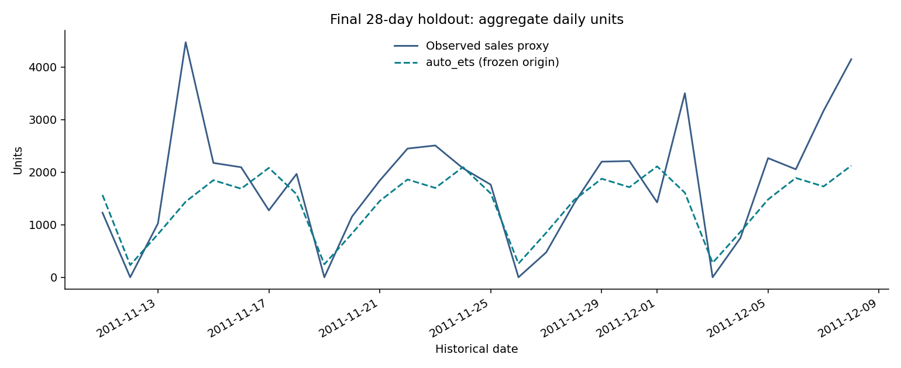

# Forecast evaluation

Measured from real UCI transactions. All figures below are calculated by `src/evaluation.py`; no random split or holdout-driven tuning is used.

## Protocol and selection

Product catalog and price/name metadata use data through **2011-08-18**, before any validation. Three expanding-history origins: 2011-08-18, 2011-09-15, 2011-10-13. Each predicts the next 28 days. The final holdout is **2011-11-11 to 2011-12-08** (700 product-days), evaluated after freezing rules, metrics, model configuration, catalog and input checksums at **2026-11-15T15:29:13.445877+00:00**. Forecasts for 7/14 days are leading portions of the same 28-day point forecast. They are reported, not used for selection.

Predeclared selection: Lowest pooled development WAPE, ties by configured model order; global model for all products; no holdout tuning. The criterion is pooled product-day WAPE, not an average of product percentages. Selected **auto_ets**, development WAPE **79.1512%** versus seasonal naive **95.2979%**; relative reduction **16.94%**. Acceptance hypothesis: at least 5% relative development reduction. **PASS**; this threshold was not changed after evaluation.

Seasonal naive repeats the latest seven daily values. Moving average repeats the latest 28-day mean. StatsForecast AutoETS searches its ZZZ error/trend/seasonal family with weekly period 7. Croston SBA is a statistical intermittent-demand candidate. AutoARIMA was omitted to keep this small CPU study bounded; no large neural model or LLM is needed. Insufficient histories/model failures use an explicitly flagged mean fallback, or zero when no history exists. Measured fallback rows: **0** across primary development and holdout comparison. Negative predictions are clamped to zero.

## Model comparison (primary 28-day horizon)

| phase       | model          |       mae |       rmse |     wape |      bias |     mase |   fallback_rows |
|:------------|:---------------|----------:|-----------:|---------:|----------:|---------:|----------------:|
| development | seasonal_naive | 51.922381 | 138.437156 | 0.952979 | -0.122473 | 1.049081 |               0 |
| development | moving_average | 50.146973 | 117.060200 | 0.920393 |  0.008154 | 1.010813 |               0 |
| development | auto_ets       | 43.124962 | 112.234531 | 0.791512 | -0.059247 | 0.876040 |               0 |
| development | croston_sba    | 49.864529 | 117.462036 | 0.915209 | -0.013236 | 0.991899 |               0 |
| holdout     | seasonal_naive | 76.448571 | 224.785288 | 1.078346 |  0.172531 | 1.275676 |               0 |
| holdout     | moving_average | 53.720714 | 153.287198 | 0.757758 | -0.136158 | 1.011416 |               0 |
| holdout     | auto_ets       | 50.010429 | 156.552272 | 0.705423 | -0.208508 | 0.921985 |               0 |
| holdout     | croston_sba    | 57.043361 | 152.538643 | 0.804626 | -0.006774 | 1.047449 |               0 |

Selected final holdout: MAE **50.0104 units/product-day**, RMSE **156.5523**, WAPE **70.5423%**, bias **-20.8508%**, MASE **0.9220**. Relative holdout WAPE reduction versus seasonal naive: **34.58%**. This is a single post-selection diagnostic; it does not alter the chosen model.

## Definitions and aggregation

For error e = prediction − observed units: MAE = mean(|e|); RMSE = sqrt(mean(e²)); WAPE = sum(|e|)/sum(|actual|); bias = sum(e)/sum(|actual|), with positive bias meaning overprediction. Mean signed unit error is also exported. All pooled metrics treat every product-day equally; WAPE's denominator is all recorded units in those rows. They do not cancel errors across products. Product-level metrics and each fold are exported separately. Aggregate calendar-day totals are plotted for interpretation, not substituted for pooled product-level accuracy.

MASE divides each absolute error by the corresponding product/fold training-only mean absolute seasonal difference |y[t]−y[t−7]|. Aggregate MASE averages defined scaled errors and reports `mase_defined_rows`. With fewer than eight training days or zero seasonal scale it is undefined. WAPE/bias are undefined if the actual-unit denominator is zero. CSV blanks and JSON null preserve undefined values; they are never replaced with zero.

## Rolling origins, 28-day horizon

|   fold | train_end           | model          |      mae |    wape |     bias |    mase |
|-------:|:--------------------|:---------------|---------:|--------:|---------:|--------:|
|      1 | 2011-08-18 00:00:00 | seasonal_naive | 48.02000 | 1.02114 |  0.02837 | 1.04939 |
|      2 | 2011-09-15 00:00:00 | seasonal_naive | 52.38571 | 0.94926 | -0.06808 | 1.08389 |
|      3 | 2011-10-13 00:00:00 | seasonal_naive | 55.36143 | 0.90399 | -0.28732 | 1.01396 |
|      1 | 2011-08-18 00:00:00 | moving_average | 48.08265 | 1.02248 |  0.33064 | 1.00422 |
|      2 | 2011-09-15 00:00:00 | moving_average | 45.84735 | 0.83078 | -0.14786 | 0.96832 |
|      3 | 2011-10-13 00:00:00 | moving_average | 56.51092 | 0.92276 | -0.09888 | 1.05990 |
|      1 | 2011-08-18 00:00:00 | auto_ets       | 38.43988 | 0.81742 |  0.14315 | 0.83942 |
|      2 | 2011-09-15 00:00:00 | auto_ets       | 40.26493 | 0.72963 | -0.10196 | 0.86319 |
|      3 | 2011-10-13 00:00:00 | auto_ets       | 50.67008 | 0.82738 | -0.17618 | 0.92551 |
|      1 | 2011-08-18 00:00:00 | croston_sba    | 47.42299 | 1.00845 |  0.30582 | 0.98270 |
|      2 | 2011-09-15 00:00:00 | croston_sba    | 46.65631 | 0.84544 | -0.13310 | 0.96899 |
|      3 | 2011-10-13 00:00:00 | croston_sba    | 55.51429 | 0.90648 | -0.15021 | 1.02401 |

## Evidence and limits

`frozen-protocol.json` records pre-holdout hashes and versions. `holdout-manifest.json` protects initial predictions/metrics from overwrite; repeated commands verify rather than retune. `future-forecasts.csv` refits all model configurations on the full prepared history only for demonstration of future inference. No future actuals are available. Point forecasts have no calibrated intervals. One annual cycle, wholesale spikes, calendar closures and stockout censoring limit transferability.

